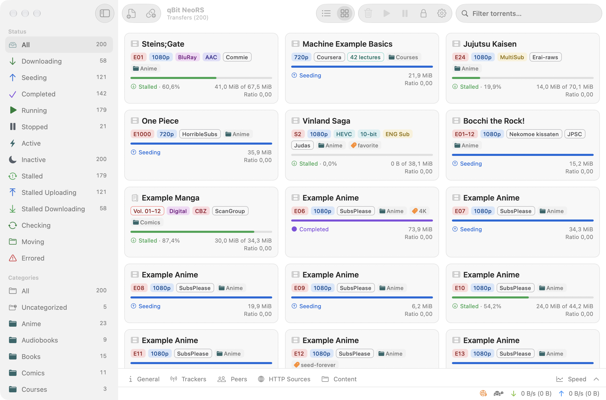
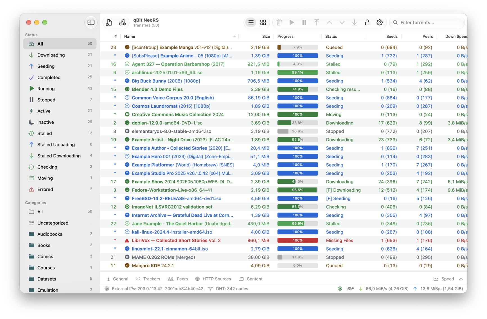

# qBit NeoRS

A native macOS BitTorrent client:
[qBittorrent](https://www.qbittorrent.org) 5.2.4 ported to a Rust core built
around the rqbit engine (librqbit), with a SwiftUI interface.

**Website:** [neors.lex.mk](https://neors.lex.mk) · Sibling project with
qBittorrent's own C++ engine: [qBittorrent Neo](https://neo.lex.mk)

* **Feature parity** with qBittorrent 5.2.4 — transfer list with every column,
  filters, categories and tags, queueing, share limits, scheduler, RSS reader
  and auto-downloader, search plugins, torrent creator, execution log,
  statistics, all preferences, and the WebAPI v2 with qBittorrent's own WebUI.
* **Small memory footprint** — one process, a compact Rust engine, data
  synchronised to the UI as diffs.
* **Native UI** — SwiftUI on macOS 27, light/dark mode, Dock and menu bar
  integration, keyboard friendly.
* **BitTorrent engine from rqbit** — the engine in `engine/` is a fork of
  [rqbit / librqbit](https://github.com/ikatson/rqbit) by Igor Katson and
  contributors, licensed under Apache-2.0. The fork adds what qBittorrent's
  feature set needs (see `docs/ENGINE.md`), and upstream improvements are
  merged regularly (`scripts/engine-upstream.sh`).

<picture>
  <source media="(prefers-color-scheme: dark)" srcset="docs/screenshots/cards-dark.png">
  
</picture>

Torrents can be shown as cards or as a list (⌘1 / ⌘2 or the toolbar switch).
Names are split by editable rules: the title is set in semibold and release
details (resolution, codec, source, group, format, version…) in regular weight
in the list, or as color-coded tags on the cards, with an icon for the kind of
content (video, music, software, game, ROM set, book, audiobook, comic).

<picture>
  <source media="(prefers-color-scheme: dark)" srcset="docs/screenshots/list-dark.png">
  
</picture>

More of the interface:

| | |
|---|---|
|  |  |
|  |  |
|  |  |

qBit NeoRS shares its interface with
[qBittorrent Neo](https://github.com/sermelipharo/qBittorrent-Neo), which runs
qBittorrent's own C++ engine (libtorrent and Qt) under the same SwiftUI app, so
the screenshots in the table come from it; only the window title differs.
Pick qBittorrent Neo if you want qBittorrent's engine exactly; pick qBit NeoRS
for a smaller, all-Rust app. qBit NeoRS is younger and less tested.

## Layout

| Path | What |
|---|---|
| `engine/` | BitTorrent engine (fork of rqbit's librqbit 9.0.1, Apache-2.0) |
| `crates/qbt-core` | Application core and WebAPI server |
| `crates/qbt-ffi` | Static library + Swift bindings for the app |
| `crates/qbt-nox` | Headless daemon with the WebUI |
| `apps/macos` | SwiftUI app (XcodeGen project) |
| `docs/` | Architecture, engine changes, security notes, parity specs |
| `reference/qBittorrent` | Upstream 5.2.4 sources (submodule, reference only) |

## Building

Requirements: macOS 27 on Apple silicon, Xcode 27, Rust (stable), XcodeGen,
SwiftLint (`brew install rust xcodegen swiftlint`).

```sh
git submodule update --init --depth 1   # optional: reference sources
scripts/build-core.sh release           # Rust core -> build/QBTCoreFFI.xcframework
cd apps/macos && xcodegen generate
xcodebuild -project QBTNeo.xcodeproj -scheme QBTNeo -configuration Release \
  -derivedDataPath ../../build/DerivedData build
open "../../build/DerivedData/Build/Products/Release/qBit NeoRS.app"
```

Headless daemon: `cargo run --release -p qbt-nox -- --webui-port 8080`.

Tests: `cargo test --workspace`.

## License

GPL-3.0-or-later. See `LICENSE` and `NOTICE` for third-party components.

## Credits

qBit NeoRS is based on [qBittorrent](https://www.qbittorrent.org); its
behavior, interface texts, WebAPI, WebUI and translations come from that
project.

* **Original author:** Christophe Dumez.
* **Current maintainer:** Sledgehammer999.
* **Contributors:** Vladimir Golovnev, Stefanos Antaris, Mohammad Dib, Mirco
  Chinelli, Ishan Arora, Arnaud Demaizière, Grigis Gaëtan, Christian Kandeler,
  Silvan Scherrer, Nick Tiskov and everyone on the
  [qBittorrent contributors page](https://github.com/qbittorrent/qBittorrent/graphs/contributors).
* **Translators:** the volunteers who translated qBittorrent, mostly through
  [Transifex](https://explore.transifex.com/sledgehammer999/qbittorrent/);
  this app reuses their translations.
* **BitTorrent engine:** a modified fork of
  [rqbit / librqbit](https://github.com/ikatson/rqbit) by Igor Katson and
  contributors (Apache-2.0, see `engine/LICENSE`), kept in sync with upstream.
* qBittorrent is licensed under GPL-2.0-or-later with the OpenSSL exception.

The About window (Credits tab) shows the same credits.

## Relationship to qBittorrent

qBit NeoRS is an unofficial project and is not affiliated with or endorsed by
the qBittorrent project or by rqbit. Please report problems with qBit NeoRS in
this repository's issues, not to qBittorrent or rqbit.
